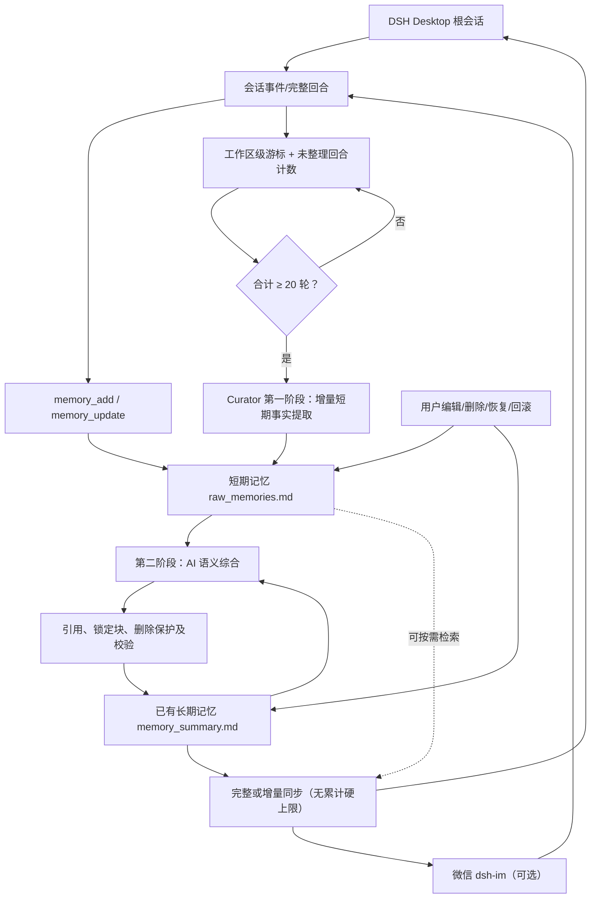

# Feiyu Memory 1.3.0 技术架构

## 两层记忆，而不是三个概念

- **短期记忆**：`raw_memories.md` 存放由 `memory_add` / Curator 提取的原子事实和状态变化。可以搜索、更新、软删除、恢复；来源、删除和修改历史独立保留。
- **长期记忆**：`memory_summary.md` 是 AI 综合后的用户认知。Curator 读取新增对话、短期记忆和现有长期记忆，语义去重、修正旧状态；用户改动可自动锁定并逐条解锁。
- **索引和历史**只是目录及管理机制，不是第三层记忆；不应把机械分组的 Markdown 拼接冒充 AI 长期总结。

## 触发与同步是两条独立链路

1. **自动总结**：所有私人工作区根会话累计 **20 个完整回合**，Curator 通过 DSH 模型服务触发两阶段整理；新建/结束根会话仅提前检查，不会绕过阈值；子代理不会独立累计。游标持久化于 `curator.json`。
2. **同步**：短期或长期记忆变化后，系统向存活根会话同步；无变化不注入、同轮多次更新合并；普通变化用增量，删除/压缩后必要时用完整快照。**没有累计 8/14 次硬上限**。
3. **上下文压缩**：监听 DSH `compaction`，在下一次可用的 `agent/pre-step` 重新提供最新长期记忆；这并不保证旧快照被物理删除。
4. **安全**：只在配置的私人工作区及根会话内注册写工具；Host 需要登录 Cookie，失败时拒绝写入；短期软删除会过滤仅由被删 ID 支持的长期 claim。语义改写仍可能逃过文本级遗忘指纹匹配。

## 关键文件

| 类别 | 路径 | 作用 |
|---|---|---|
| 短期记忆 | `raw_memories.md` | 原子事实；有效、软删除 |
| 长期记忆 | `memory_summary.md` | AI 合成后的认知和用户锁定块 |
| 历史 | `summary_history/` | 长期版本历史、索引及回滚 |
| 修改/删除 | `revisions.jsonl` / `tombstones.jsonl` | 修订快照与删除指纹 |
| 状态 | `state.json` / `curator.json` | 模式、游标、阈值、整理状态 |
| 日志 | `journal.jsonl` | 追踪写操作 |
| 插件宿主 | `lib/index.js` | 工具、Host API、会话与注入 |
| AI 总结 | `lib/curator.js` | 两阶段 Curator |
| 快照 | `lib/injection.js` | 同会话/跨会话同步与完整快照 |
| 用户设置 | `lib/client.js` | 短期/长期编辑、删除、锁定、回滚 |

## 12 个记忆工具

`memory_add`、`memory_update`、`memory_search`、`memory_curate`、`memory_consolidate`、`memory_status`、`memory_forget`、`memory_restore`、`memory_summary_rollback`、`memory_history`、`memory_revert`、`memory_trace`。

长记忆编辑和逐块解锁使用设置页 Host API，不额外注册第十三个模型工具。

## 兼容性

本仓库新的 `plugins/feiyu-memory/` 是 `dsh-memory-feiyu 1.3.0`，不等于历史 `plugins/memory/`（`dsh-memory-scoped 0.2.1`）。从旧版升级需要审查数据结构、备份与来源，不能仅替换文件名。功能基于维护者在 Windows DSH Desktop 0.2.2-rc.1 的实际验收，不等于对所有 DSH 版本的兼容承诺。
