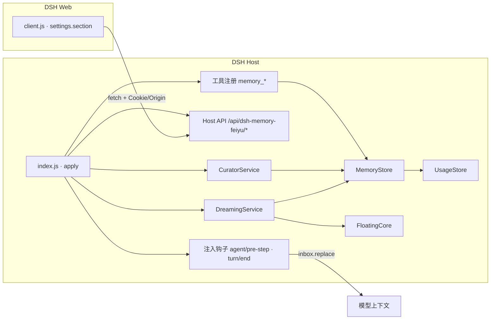

# 架构说明

## 1. 位置：插件在 DSH 里挂在哪

`dsh-memory-feiyu` 是一个 DSH **bundle + Host 插件 + Web 客户端插件**三合一包：

```
profile/
  package.json              dsh.profile.bundles: [..., "dsh-memory-feiyu"]
  cordis.patch.yml          ← 本包的配置落在这里（privateWorkspace / 预算）
  node_modules/dsh-memory-feiyu/
    lib/index.js            Host 侧：注册 15 个工具、Host API、注入钩子
    lib/client.js           浏览器侧：设置页「记忆」
    cordis.patch.yml        随包默认配置
```



## 2. 模块职责（`lib/`）

| 模块 | 行数量级 | 职责 | 纯函数？ |
|---|---|---|---|
| `store.js` | ~2100 | 短期记忆读写、长期版本与索引、冷库归档、墓碑、journal、原子写、损坏恢复 | 否（文件 IO） |
| `summary.js` | ~430 | 长期记忆锁定块、引用解析、删除清洗、哈希校验 | 大多是 |
| `index.js` | ~2050 | 插件入口：配置 schema、工具注册、Host API、注入调度、命中结算 | 否 |
| `curator.js` | ~1590 | 两阶段 Curator：预算组装、JSON 提取、耐久性闸门、长期合成与校验 | 部分 |
| `dreaming.js` | ~1060 | Dreaming：阈值判断、输入组装、CAS 提交、快照与回滚 | 部分 |
| `core.js` | ~835 | 浮动核心：解析/渲染/校验/来源/墓碑/历史 | 部分 |
| `injection.js` | ~517 | 索引渲染、完整快照、增量 diff、压缩后重注入 | 大多是 |
| `usage.js` | ~375 | 有效命中 WAL + 快照折叠 | 否 |
| `activity.js` | ~130 | 活跃度评分、低活跃归档选择 | 是 |
| `config.js` | ~330 | 默认值、校验、工作区路径判定、上下文预算 | 是 |
| `feiyu.js` | ~210 | 预算小工具、legacy 摘要、时间显示 | 是 |
| `search.js` | ~150 | ID / 标签 / 关键词 / 中文 n-gram 检索打分 | 是 |
| `text.js` | ~100 | UTF-8 字节、token 估算、按预算截断 | 是 |
| `client.js` | ~2100 | 设置页 UI（React，DSH 客户端模块） | 否 |

`lib/types/index.d.ts` 是给调用方看的类型声明。

## 3. 关键不变量（改代码前先读这段）

1. **短期记忆是唯一事实源**；长期记忆与浮动核心都是派生视图，必须能追到短期 ID。
2. **删除是软删除**：`raw_memories.md` 里只加三行元数据；`tombstones.jsonl` 只追加。
3. **已删除内容不得复活**：`memory_add` 命中墓碑 → 拒绝；长期合成出现已删原文 → 拒绝；
   Dreaming 回滚复活已删核心 → 拒绝。
4. **锁定块逐字保留**：用户编辑过的段落带 `feiyu-lock` 标记，AI 改写即拒绝写入。
5. **注入幂等**：快照只由文件内容 + 固定配置生成，不含时间戳/随机数；内容不变不重复注入。
6. **预算双向约束**：任何一次注入都同时受字节与 token 约束；长期记忆优先于索引。
7. **fail-closed**：Host 认证缺失/异常 → 503/403；设置页拿不到认证 → 只读。
8. **根会话独占**：子代理、fork、非私人工作区会话一律拒绝读写。

## 4. 一次写入的完整路径

```
模型调用 memory_add
  → assertNoSecrets(正文/概述/标签/来源/上下文/引文)       ← 秘密拒绝
  → contentFingerprint → 查 tombstones / 已删条目          ← 复活拒绝
  → 生成唯一 mem-xxxxxxxx
  → renderEntry() → 原子追加 raw_memories.md
  → journal({op:'add'})
  → usage.recordContentUpdate(id)                          ← 活跃度基线
  → queueMemoryForLiveAgents()                             ← 给存活根会话排队注入
turn/end
  → settleHits()：命中结算写入 usage.jsonl
  → Curator 阈值检查（工作区未整理回合 ≥ 20）
```

## 5. 原子写与崩溃恢复

- 所有写文件走「临时文件 → rename」，避免半截文件；
- `state.json` 之外另存 `state.json.bak`，损坏时回退并标记 `stateRecovered`；
- `raw_memories.md` 解析失败的块进 `corrupt/`，原文件不被覆盖，`parse-diagnostics.json` 记诊断；
- `summary_history/index.json` 与版本文件不一致时进入**只读保护**：暂停编辑/回滚/新增长期写入，
  提示运行 `repair-summary-index`；
- `usage.jsonl` 是 append-only WAL，崩溃后重放；超过 `usageCompactAfterLines` 折叠进 `usage.json`。

## 6. 并发

- 同一进程内：`MemoryStore._exclusive()` 串行化所有写操作；长期写入另有 `withLongTermLock`（可重入）。
- 跨进程：只有 `longterm.lock` 文件标记，没有跨进程协调。**同一记忆目录只应由一个 DSH 实例写**。
- Curator / Dreaming 各自有每小时次数、冷却、启动延迟，避免开机风暴。

## 7. 注入算法（增量优先）

```
agent/pre-step(根会话)
  if 无基线快照        → 完整快照
  else if 有删除       → 完整快照
  else if 同轮变化 > fullSyncChangedEntries → 完整快照
  else if 增量超单条容量 → 完整快照
  else if 刚发生 DSH 压缩 → 完整快照（压缩摘要会保留旧快照）
  else                → 增量（只带新增/修改/删除的条目）
  统一：同轮多次写入用 inbox.replace() 合并成最多一条
```

单条容量：增量 12000 B / 4000 tokens；完整快照默认不按模型窗口比例封顶（两个比例均为 0），
仍受各层独立容量保护。显式启用比例预算时可设置 8% / 10%，读不到窗口时才回退至配置值（默认 8192 tokens）。

## 8. 设置页与 Host API

| 接口 | 用途 |
|---|---|
| `POST /api/dsh-memory-feiyu/state` | 各层状态、总览、浮动核心、命中、Dreaming、预算 |
| `POST /api/dsh-memory-feiyu/long-term` | 长期记忆逐条编辑/解锁/删除 |
| `POST /api/dsh-memory-feiyu/{update,history,revert,forget,restore,rollback,...}` | 短期与版本操作 |
| 浮动核心 / 冷库 / Dreaming 操作 | 同一前缀下的 action 路由 |

所有接口经 `guarded()` 包装：只接受 DSH `connection.admit` 的 Host/Origin + Cookie/Peer 认证，
并额外要求 `x-dsh-memory-client` 头。认证服务缺失或抛异常时 **fail-closed**。

## 9. 为什么不用向量库

- 私人记忆规模在数百到数千条，关键词 + 中文 n-gram 足够；引入 embedding 会带来外部服务依赖、
  隐私外发和“相似但错”的召回；
- 记忆的价值在于**可溯源**：每条都能回到 turn/seq 的原话。向量相似度不提供这种证据链；
- 预算受限场景下，索引 + 主动检索比 top-k 注入更省 token。

这也是 v2.0 的设计取舍：宁可让模型多调一次 `memory_search`，也不要注入一堆“看起来相关”的段落。
