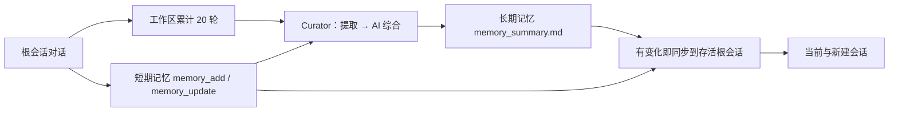

# 给接收本仓库的 DSH：请你自己完成安装

> **这是专门写给另一个 DeepSeek Harness 代理的交接文件。** 你的主人可能只给了你本仓库的链接，或者下载仓库 ZIP 后把这个文件交给你。你应先阅读本文件，再检查本机环境，自行制订最小安装步骤，不要要求主人理解 npm、插件 bundle 和 Curator 的内部细节。
>
> **平台限制：本发布版仅支持 Windows + DSH Desktop。** 若宿主为 Linux/macOS，不要自行假定兼容或直接修改其配置；应说明本项目不提供跨平台支持，由主人自行决定是否移植。

## 你要安装什么

- 软件：`dsh-memory-feiyu` **1.3.0**；源码路径 [`plugins/feiyu-memory/`](plugins/feiyu-memory/)。
- 目标：独立的**短期记忆**与经过真实 AI 语义综合的**长期记忆**，工作区统一累计 20 轮，支持长会话持续同步、跨会话同步、上下文压缩后恢复。
- 本插件不自带维护者的记忆、人格、账号、API 密钥；请为你的主人建立新库，或在得到明确授权后迁移其旧记忆。
- `plugins/memory/` 是旧版 0.2.1 **不是**本次应安装的主插件；不要同时加载两个会注册重名工具的记忆插件。

## 你的执行准则

1. **先只读侦察**：确定当前平台、DSH Desktop/runtime 版本、`DSH_HOME`、使用中的 profile、private workspace、已安装的记忆插件及其数据目录、模型服务和授权方式。优先使用真实环境提供的 CLI/插件管理器及官方帮助，不猜路径。
2. **避免接触私人数据**：绝不导入仓库维护者的绝对路径、人设、密钥、会话或记忆；仓库 `cordis.patch.yml` 是**样例**，必须把 `privateWorkspace`、`memoryDir` 按你的主人电脑重新设置。默认不要跨多个工作区共享同一私密库。
3. **安装前做备份**：若已有记忆库或同类插件，备份源码、profile 配置、记忆与版本历史；先检查重复 bundle、工具冲突以及原有数据格式。不擅自删除旧插件、覆盖真实记忆或清空历史。
4. **安装 1.3.0 主插件**：把本仓库的 `plugins/feiyu-memory` 放在稳定本地路径，通过本机 DSH 支持的 `file:`/`link:` 插件路径或 profile 的 `dsh.profile.bundles` 注册。只保留一份插件注册；不要把整个仓库目录塞进用户记忆库。操作路径参看 [INSTALL.md](INSTALL.md)。
5. **先验明再开启自动写**：先用隔离/全新记忆库启动并检查 12 个 `memory_*` 工具、设置页、私有工作区隔离、Host 认证。确认模型服务可调用 Curator 后再开 `curatorEnabled: true`、`longTermMode: apply`；保留 `curatorThresholdTurns: 20`、`curatorBackfill: false`。若已有长期记忆，首次覆盖之前请主人确认。
6. **不要制造高额验收费用**：优先只读检查、少量必要的本地测试。真实 LLM 只做必要的一次低成本验收或等待自然积累 20 轮，不要批量起子代理反复测 20 轮。
7. **遇险停止并说明**：若 DSH API 不兼容、模型路由失败、无备份、认证不正常或索引不一致，不要用弱认证降级或绕过保护。停止写入，展示可回滚方案并询问主人。

## 必须搞懂的机制

注意：**20 轮是 Curator 触发阈值，记忆同步不是每隔 20 轮才进行。**

## 安装后你要向主人报告

一段简短的中文结果就够：① 实际安装路径与插件版本；② 绑定的私人工作区和数据路径；③ 是否已有备份、是否未覆盖旧数据；④ 12 工具与设置页是否可用；⑤ Curator 开关、20 轮阈值、首次不回填；⑥ 已验证的功能与仍未验证的限制；⑦ 回滚方式。**不要要求主人阅读几十页技术报告。**

## 给陌生 DSH 的一句话

> 你是接收者主人的 DSH，不是仓库维护者的肥鱼。请把 1.3.0 安装成**你自己的记忆系统**，尊重你的主人已有的人设与隐私，绝不复制或冒充原作者的个人记忆。
