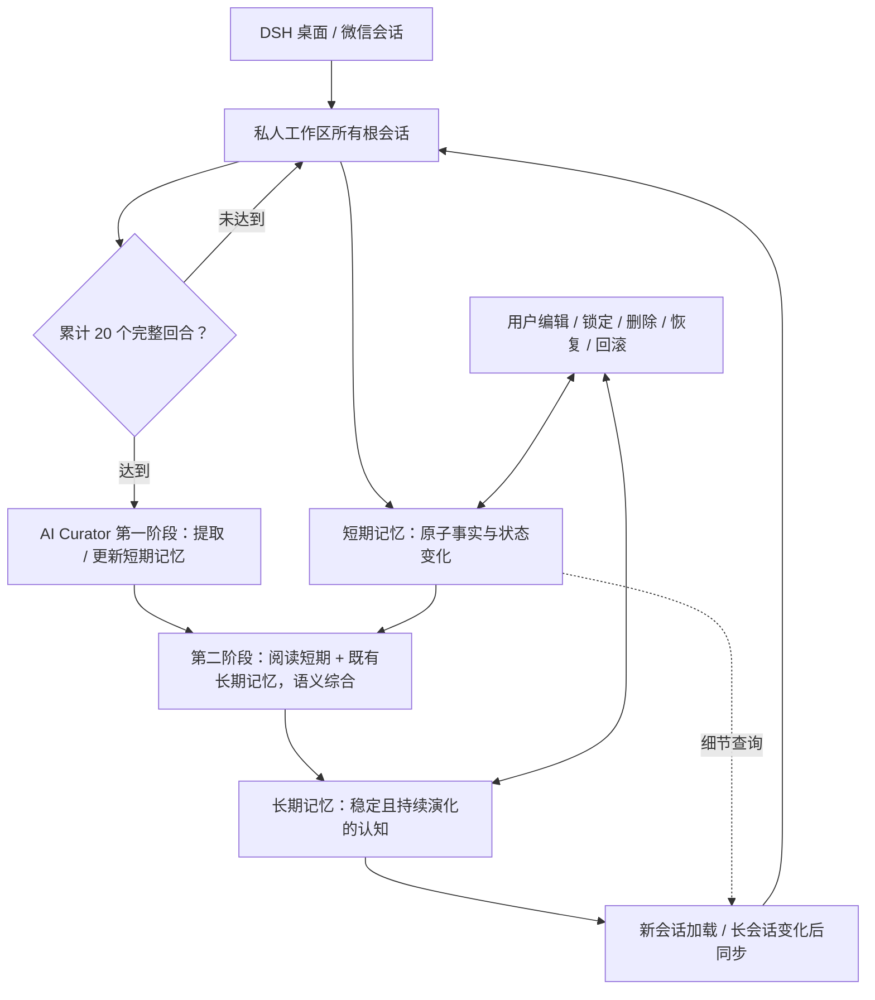

# DeepSeek Harness 两层长期记忆 · Feiyu Memory 1.3.0

> 🐟 **让 DSH 不只记住聊天内容，还能定期理解、修正和更新对你的认识。** 这是面向 Windows 平台 DeepSeek Harness Desktop 的非官方、本地优先、按工作区隔离的两层记忆插件。
>
> **平台支持：Windows。** Linux / macOS 不在本项目支持与 CI 验证范围内；欢迎自行移植，但不作兼容性承诺。

**给朋友或新设备安装？** 不必研究所有源码：把这个仓库地址和 **[📖 INSTALL_FOR_DSH.md — 给陌生 DSH 的安装交接书](INSTALL_FOR_DSH.md)** 发给你的 DSH，让它先读取说明，再自行适配安装。安装前需要你授权本地文件/配置变更。

[安装说明](INSTALL.md) · [架构与数据流](ARCHITECTURE.md) · [功能与验证状态](STATUS.md) · [插件源码](plugins/feiyu-memory/) · [旧版 v0.2.1](plugins/memory/)

## 主要能力

| 能力 | 1.3.0 的实现 |
|---|---|
| **短期记忆** | `memory_add`、`memory_update` 等提取单条事实；可查、改、删、恢复、溯源 |
| **长期记忆** | AI Curator 综合新增对话、短期记忆与现有长期认知，语义总结、去重、纠错、更新 |
| **累计 20 轮** | 同一个私人工作区内所有根会话累计 20 个未整理完整回合才触发；不要求每个会话满 20 轮 |
| **长会话持续同步** | 记忆有变化即同步，不受固定累计次数限制；无变化不重复注入 |
| **跨会话 / 压缩后恢复** | 工作区级记忆共享；新旧会话同步；DSH `/compact` 后重注入最新记忆 |
| **用户掌控** | 设置页编辑两层记忆；长期记忆段落锁定/解锁、删除与版本回滚 |
| **数据安全** | 私人工作区隔离、来源校验、删除保护、Cookie 认证、备份与版本历史 |

## 工作原理



**20 轮是 AI 自动整理阈值，不是记忆同步间隔。** 平时 `memory_add` 或编辑发生变化后也可以同步；Curator 不会无变化就强制生成新长期版本。锁定的人为修正不能被自动总结随意覆盖。

## 给 DSH 一句话

> 请阅读 `https://github.com/hermit32/dsh-long-term-memory/blob/main/INSTALL_FOR_DSH.md`，按文档安全安装 **Feiyu Memory 1.3.0**。先检查你的 DSH 版本、工作区、已有记忆和备份，替换示例路径，不要导入维护者个人数据。需要我授权时再询问。

## 项目目录

```text
plugins/
  feiyu-memory/          # 1.3.0：当前主插件，12 个 memory_* 工具
  memory/                # v0.2.1：历史公开实现（dsh-memory-scoped）
  session-manager/       # 历史配套插件，可选
  persona/               # 可选：人设样例（AGENTS.md + 大肥鱼人设.md），不会被自动加载
INSTALL_FOR_DSH.md       # 供另一台 DSH 自主执行的安装交接书
INSTALL.md               # Windows / DSH Desktop 安装及升级说明
ARCHITECTURE.md          # 两层记忆的技术架构与数据流
STATUS.md                # 实际验收与仍未验证的边界
THIRD_PARTY_NOTICES.md   # 第三方来源及许可提示
```

## 本地验证（约 3 分钟）

克隆后**必须先在插件目录装依赖**，再跑测试；跳过这一步会报
`ERR_MODULE_NOT_FOUND: Cannot find package '@deepseek-ai/schemastery'`。

```powershell
git clone https://github.com/hermit32/dsh-long-term-memory
cd dsh-long-term-memory\plugins\feiyu-memory
pnpm install --frozen-lockfile     # 也可以用 npm install；只需要 @deepseek-ai/schemastery
node --test                         # 1.3.0 主套件：178 项 / 177 通过 / 1 跳过 / 0 失败

cd ..\..
powershell -ExecutionPolicy Bypass -File .\tests\run-all.ps1      # 全部套件
powershell -ExecutionPolicy Bypass -File .\tests\privacy-scan.ps1 # 隐私扫描，0 命中才通过
```

- `node --test` 必须在 `plugins/feiyu-memory` 里执行：那里才有 `package.json`、`pnpm-lock.yaml` 和 `test/`。
- 只安装插件、不跑测试的使用者**不需要**手动 `pnpm install`：DSH 插件管理器会按 `package.json` 装依赖。
- 唯一跳过的 1 项是"固定人设没有被写进长期记忆摘要"，它需要一份真实记忆库才能判断；没有本地记忆库时自动跳过，不算失败。

## 已知状态与边界

- 维护者于 **2026-11-06** 将个性化 1.3.0 部署至 DSH Desktop，生产运行显示插件已加载、Curator 开启、阈值 20、无启动错误。干净克隆可复现 **178 项 / 177 通过 / 1 跳过 / 0 失败**；隔离真实 DSH 完成 5×4 轮触发、真实模型总结、跨会话同步、手动压缩及 Web 进程重启演练。
- **不保证其他机器零配置安装。** DSH 处于快速迭代期；全新 Windows 环境安装、长时间压力测试与实际微信 `/new` 全链路仍需接收方验证。
- **不要把生产记忆库提交到 GitHub**。此仓库不包含维护者的个人记忆、会话、密钥、`.dsh` 目录或备份。
- AI 记忆会消耗模型 Token；20 轮通常是低频整理，具体费用取决于你使用的模型和上下文。

## 许可与鸣谢

旧版 `plugins/memory/` 基于开源 `dsh-memory` 修改，保留其 MIT 归属；新版候选 `plugins/feiyu-memory/package.json` 目前声明 `UNLICENSED`，**不能因此推断新版代码已整体采用 MIT 授权**。关于新版再分发许可请见 [新版授权说明](LICENSING_1_3.md) 与 [第三方声明](THIRD_PARTY_NOTICES.md)。本项目与 DeepSeek 官方无隶属关系。
