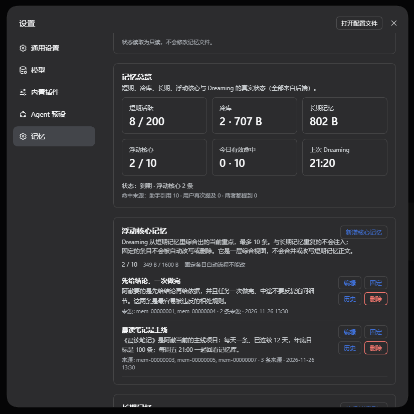
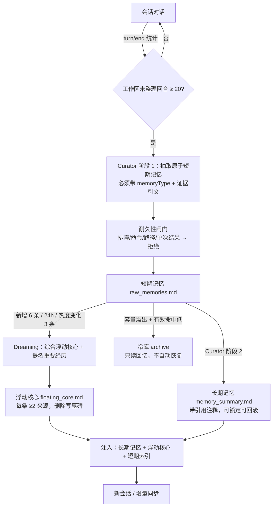
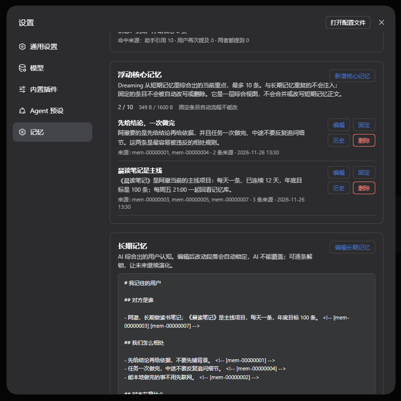
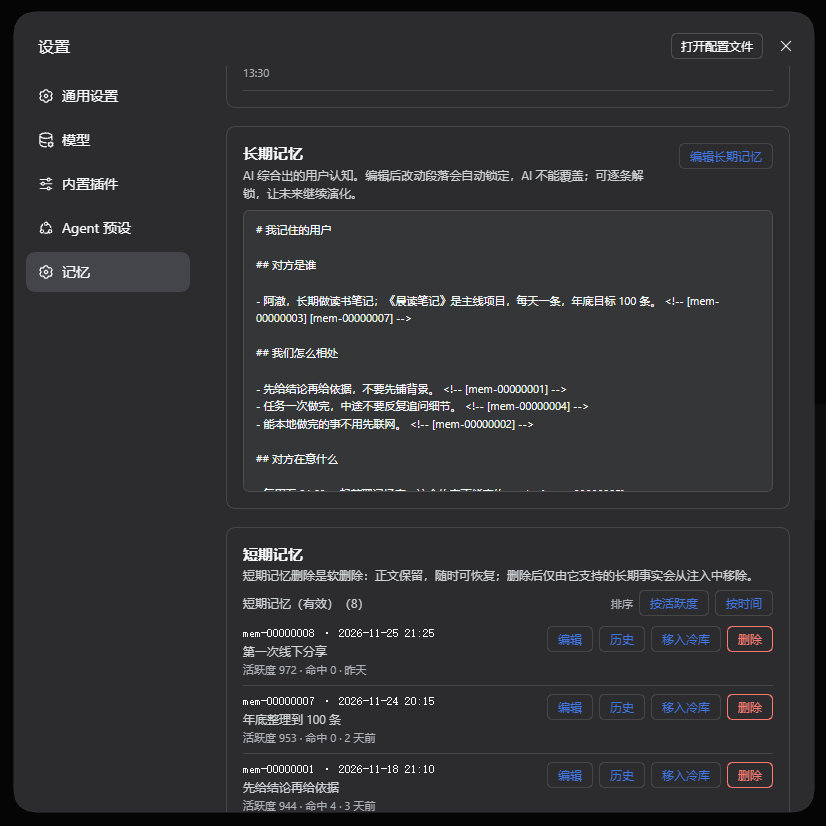
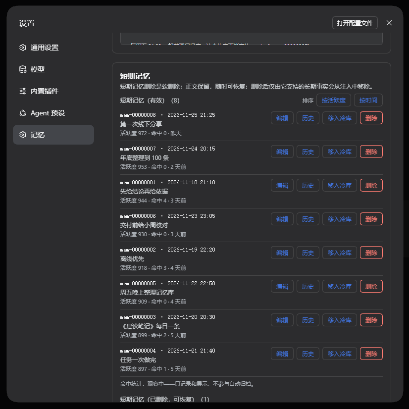
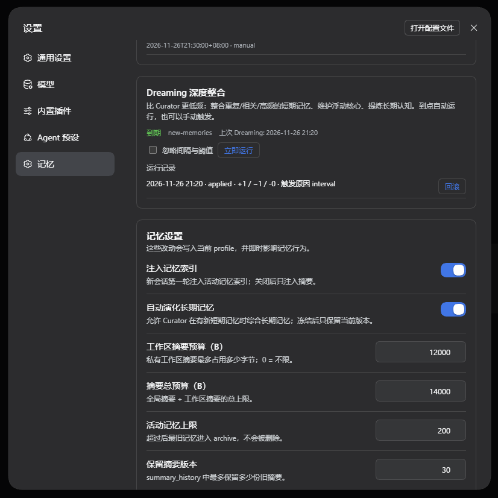
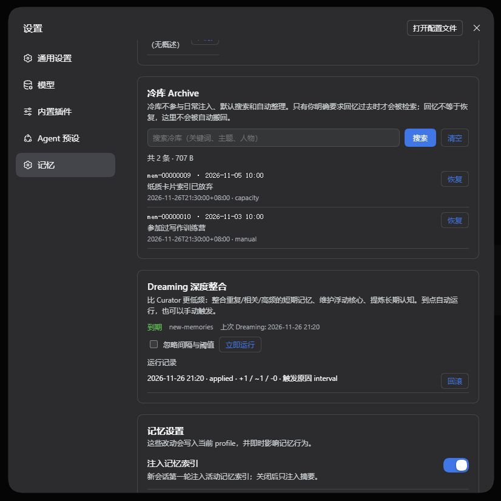
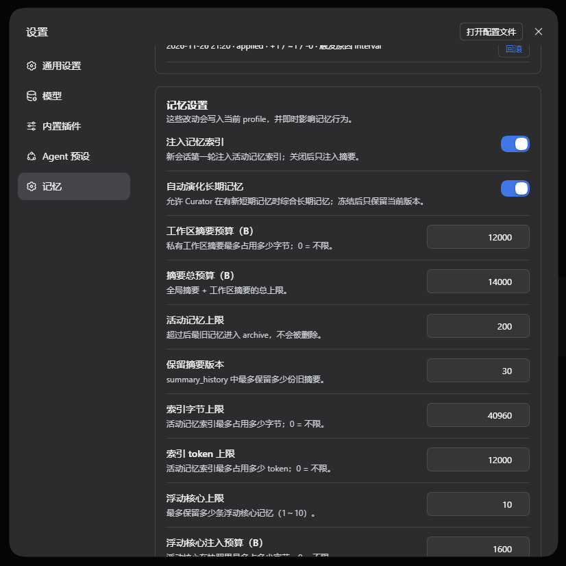

# Feiyu Memory · 肥鱼记忆系统 2.0.2

  

> 让 DeepSeek Harness 不只记住对话，还能持续整理、理解和修正对用户的认识。

[安装教程](INSTALL.md) · [交给 DSH 自动安装](INSTALL_FOR_DSH.md) · [架构](ARCHITECTURE.md) · [版本记录](CHANGELOG.md) · [验收状态](STATUS.md)

**从 1.3.0 升级？** 本仓库现以独立的四层记忆插件为主，旧版及原配套工具仍保存在 [历史版本](https://github.com/hermit32/dsh-long-term-memory/tree/c255150fadc3541e78c50a967da6ba19370e512e)。升级前备份本地记忆与配置，不要同时加载两个版本。

[DeepSeek Harness](https://github.com/deepseek-ai/deepseek-harness) 的**长期记忆插件**：把一次会话里的对话沉淀成四层可检索、可回滚、可解释的记忆，并在后续会话里按预算注入上下文。

它不是一个“把聊天记录塞进向量库”的检索器，而是一套**有分层、有闸门、有墓碑、有预算**的记忆流水线：

- 短期记忆是**原子事实**，不是对话摘要；
- 长期记忆是 AI 综合出的**人物档案**，不是工作日志；
- 浮动核心是 2～10 条**当前最在意的综合结论**；
- 冷库是**不再参与日常注入、但永不删除**的历史。

> 本仓库是公开版本：所有演示数据都是虚构的（示例用户「阿澈」、演示助手「小满」），
> 不含任何真实用户记忆、私人对话或凭据。见 [隐私与脱敏](#隐私与脱敏)。



<sub>设置 → 记忆：短期 8/200、冷库 2 条、长期记忆 802 B、浮动核心 2/10、命中来源分解（数据为虚构演示库）</sub>

## 目录

- [它解决什么问题](#它解决什么问题)
- [四层记忆](#四层记忆)
- [核心机制](#核心机制)
- [界面预览](#界面预览)
- [功能状态](#功能状态已实现--已验证--实验性--未实现)
- [安装](#安装)
- [使用](#使用)
- [数据目录](#数据目录)
- [配置](#配置)
- [隐私与脱敏](#隐私与脱敏)
- [测试与验证](#测试与验证)
- [已知限制](#已知限制)
- [许可证](#许可证)

## 它解决什么问题

LLM 会话窗口有限，而“这个人是谁、我们怎么相处、哪些事别再问一遍”这类信息必须跨会话存在。常见做法有两条路，各有硬伤：

| 做法 | 硬伤 |
|---|---|
| 直接把历史对话拼进上下文 | 窗口很快爆掉；旧对话里大量排障、命令、路径污染判断 |
| 事后做一段摘要 | 摘要会漂移、会丢来源、会无法回滚；一条摘要错到底 |

`dsh-memory-feiyu` 的做法是把两者拆开：

1. **短期记忆**只存原子事实，带 ID、标签、时间、来源引文和指纹；
2. **长期记忆**由模型从短期记忆里综合，提示词要求逐条附来源引用（行末 HTML 注释），但模型可能漏写；校验器拒绝不存在的活动短期记忆 ID，正文不写日期和编号；
3. 注入时**索引 + 长期记忆 + 浮动核心**分层给，索引只是目录，细节要求模型主动检索；
4. 删除是**软删除 + 墓碑**，被删内容不会被下一次综合偷偷写回来。

## 四层记忆

| 层 | 文件 | 上限 | 谁写 | 参与注入 |
|---|---|---|---|---|
| 短期记忆 | `raw_memories.md` | 200 条 / 300 KB | 模型工具 / Curator / 用户 | 索引（按预算裁剪） |
| 长期记忆 | `memory_summary.md` | 12 KB / 4000 tokens | Curator 综合 / 用户编辑（可锁定） | 全文 |
| 浮动核心 | `floating_core.md` | ≤10 条 / 1600 B | 仅 Dreaming + 用户 | 全文 |
| 冷库 Archive | `archive/raw_memories.md` | 无上限 | 容量溢出 / 手动归档 | **不注入**，只在 `memory_recall` 时检索 |



## 核心机制

### 1. 两阶段 Curator（不是一次性摘要）

- **阶段 1 · 短期提取**：读新增对话 + 现有目录，只输出 `add/update` 原子条目。每条必须带 `memoryType`（preference / goal / relationship / decision / project / important_event / boundary / profile）和 1～3 条证据。证据的 `sessionId/turn/seqStart/seqEnd/quote` 必须是输入里的原文连续子串。
- **耐久性闸门**：排障过程、报错、命令、脚本、路径、端口、UI 坐标、安装步骤、单次任务结果、当天状态、待办一律拒绝写入长期记忆。
- **阶段 2 · 长期合成**：读当前长期记忆、锁定块、变更条目全文、人物候选目录、已删除内容（只给不可逆短哈希占位），输出一整份 Markdown 人物档案。
- 输出被 `max-tokens` 截断时自动延长重试；仍截断就**不写入半截文本**。

### 2. 有效命中（只统计“真的被用到”）

命中不是“检索了一次”就算。轮末才结算：

1. 工具检索先登记候选；
2. 轮末检查该轮**助手回复**是否引用了它（记忆 ID / 原话引文 / 概述原文），以及**用户自己**是否再次提及同一条；
3. 只有命中才追加 `usage.jsonl`，同会话同轮同条只计一次，单条每天最多 5 次。

自动注入、未被引用的搜索结果、Curator/Dreaming 的扫描都不计入。默认 `hitStatsMode=observe`：只统计、只展示，**不参与**自动归档。

### 3. 活跃度淘汰，而不是按创建时间淘汰

活跃度 = 最后一次有效引用的指数衰减（主）+ 命中频率与重要度（辅）。容量溢出时按活跃度**从低到高**搬进冷库；最近 24 小时活跃过的条目和重要度 3 的记忆有保护窗口（严重超容时才让位，且永远保留最新一条）。

### 4. Dreaming 深度整合

比 Curator 更低频的一层：把短期记忆里反复出现、彼此相关的内容综合成浮动核心，并提名“值得直接进入长期记忆”的重要经历。

- 计划-提交用**核心状态指纹 CAS**：提交时发现核心被用户改过，整次放弃；
- 每次落地前写 `dream/<runId>/` 快照（含 sha256 清单）；
- 回滚先校验快照哈希，再校验当前墓碑、固定状态与已删引用，**会复活已删内容或改写固定条目的回滚一律拒绝**。

### 5. 注入：增量优先，取消累计上限

- 新会话第一轮注入：全局摘要 + 长期记忆全文 + 浮动核心 + 短期索引 + 索引使用规则；
- 同轮多次写入不逐次注入：`turn/end` 统一计算最终状态，用 `agent.inbox.replace()` 合并成一条；
- 之后只同步**新增/修改/删除**的条目；删除、同轮变化过多、增量超单条容量、DSH 压缩后改用完整快照；
- 单条容量保护 12000 B / 4000 tokens；**会话内累计次数不设上限**，长会话可以无限期持续同步；
- 记忆没变化就不注入；完整快照只由文件内容生成，不含时间戳或随机数。

## 界面预览

以下截图都是**真实 DSH Web 界面**，在隔离环境里跑公开版插件、加载虚构演示库后抓取（`screenshots/`）。

| 浮动核心记忆（≤10 条，带来源） | 长期记忆（引用沉到注释里） |
|---|---|
|  |  |

| 短期记忆（按活跃度排序、命中统计） | Dreaming（到期原因、运行记录、回滚） |
|---|---|
|  |  |

| 冷库 Archive（回忆不等于恢复） | 记忆设置（开关与各级预算） |
|---|---|
|  |  |

> 截图顶部那条“状态读取为只读”来自隔离环境的认证限制（截图用的 profile 没开配置写入），
> 正常安装后设置页可写。

## 功能状态（已实现 / 已验证 / 实验性 / 未实现）

### 已实现且有自动化测试覆盖

| 能力 | 说明 |
|---|---|
| 短期记忆 CRUD + 软删除 + 墓碑 | 正文/概述/标签/引文可改，改前自动留快照，可回退 |
| 长期记忆版本与回滚 | `summary_history/` 最多 30 份，回滚前先归档当前版本 |
| 长期记忆锁定块 | 用户改动段落自动锁定，AI 不可覆盖，可逐条解锁 |
| 遗忘保护 | 已删除内容不得以任何形式重新写回长期记忆 |
| 证据溯源与四层校验 | 指纹 / 会话存在 / 坐标命中 / 正文支持，四层分开报告 |
| 冷库 Archive | 容量溢出与手动归档；`memory_recall` 只读，不自动恢复 |
| 有效命中统计 | append-only WAL + 快照折叠，崩溃后可重放 |
| 活跃度排序与保护窗口 | 淘汰只看活跃度，不看创建时间 |
| 浮动核心 | 来源校验、质量闸门、重合检测、墓碑、历史回退 |
| Dreaming | 阈值触发、CAS 提交、快照与安全回滚 |
| 增量注入与压缩后重注入 | 同轮合并、跨会话同步、重启恢复 |
| 设置页（7 个区块） | 总览 / 浮动核心 / 长期 / 短期 / 冷库 / Dreaming / 配置 |
| 工作区隔离 | 只在 `privateWorkspace` 内注册工具与注入；子代理拒绝 |
| 秘密拒绝写入 | 正文、概述、标签、上下文、引文、删除原因全部过检测 |
| Host 接口 fail-closed | 认证缺失/异常一律 503/403，不回退弱认证 |
| 索引修复脚本 | `repair-summary-index` 安全修复 `summary_history` 索引 |

### 已验证（在真实 DSH 里跑通过）

- 设置页真实渲染与交互（`screenshots/` 全部由真实 DSH Web 抓取，数据为虚构演示库）；
- 真实模型的两阶段 Curator 与 Dreaming 链路；
- 长会话（20+ 轮）持续同步、DSH 压缩后重注入、跨会话同步、重启恢复。

### 实验性（默认关闭或需要显式开关）

| 项 | 状态 |
|---|---|
| `hitStatsMode=enforce` | 命中参与淘汰。默认 `observe`，需要真实对话验证过误计后再切 |
| `longTermMode=preview` | 只生成长期记忆预览不落盘，用于观察模型输出 |
| `curatorBackfill=true` | 回填历史会话；默认只建立新游标，不重放历史 |
| Dreaming 热度触发 | `dreamingHeatThreshold`，默认 3 条命中变化触发 |

### 未实现 / 明确不做

- **短期记忆正文的深度合并/改写**：插件不会把多条短期记忆合成一条新的短期条目。跨条目综合只发生在浮动核心与长期记忆。
- **向量检索 / 语义搜索**：当前是 ID、标签、关键词与中文 n-gram；没有 embedding 索引。
- **多用户并发写入的 OS 级隔离**：工作区路径检查是应用层隔离，不是操作系统级多用户隔离。
- **跨设备同步**：记忆是本地文件，没有云同步。

## 安装

前置：一个可用的 DeepSeek Harness（Web 或 Desktop profile），Node ≥ 22。

```powershell
# 1. 取代码
git clone https://github.com/hermit32/dsh-long-term-memory.git
cd dsh-long-term-memory

# 2. 放进你的 DSH profile
$profile = "$env:USERPROFILE\.dsh\profiles\desktop"
Copy-Item . "$profile\node_modules\dsh-memory-feiyu" -Recurse -Force

# 3. 把插件加进 profile 的 bundle 列表
#    编辑 $profile\package.json，在 dsh.profile.bundles 里加一行 "dsh-memory-feiyu"

# 4. 改路径：编辑 $profile\cordis.patch.yml（或插件目录里的同名文件）
#    privateWorkspace / memoryDir / globalMemoryDir 指向你自己的私人工作区

# 5. 重启 DSH
```

详细步骤、目录布局差异、故障排查见 [INSTALL.md](INSTALL.md)。

也可把本仓库地址与 [INSTALL_FOR_DSH.md](INSTALL_FOR_DSH.md) 发给自己的 DSH，授权后由它适配安装。

装好后打开 `设置 → 记忆`，能看到总览卡片即成功。

**随包默认配置**：Curator 自动整理关闭（`curatorEnabled: false`），长期自动合成关闭（`longTermMode: off`），但 Dreaming 默认开启（`dreamingEnabled: true`），在模型路由可用且满足触发条件时仍可维护浮动核心。若希望先只观察短期记忆与注入，请显式关闭 Dreaming。
要逐步启用 Curator、长期合成及 Dreaming，按
[INSTALL.md C 节：启用自动整理](INSTALL.md#c-启用自动整理curator--长期合成--dreaming)
逐步打开（推荐顺序：只观察 → `longTermMode: preview` → `apply` → 开 Dreaming）。

## 使用

插件注册 15 个模型工具（只在私人工作区的**根会话**可用）：

| 工具 | 用途 |
|---|---|
| `memory_search` | 检索活动短期记忆（默认不含冷库），支持 ID / 标签 / 关键词 / 中文 n-gram |
| `memory_recall` | 按需回忆过去，默认只查冷库；**只读**，不把条目搬回短期记忆 |
| `memory_add` | 写入一条短期记忆；秘密与被删除过的事实会被拒绝 |
| `memory_curate` | 按预算返回长期记忆全文 + 短期条目材料 |
| `memory_consolidate` | 显式写入/切换长期记忆，默认 manual 冻结自动演化 |
| `memory_core` | 查看/新增/修改/固定/删除浮动核心，查看历史并逐条回退 |
| `memory_dream` | 查看 Dreaming 状态、立即运行、回滚某次运行 |
| `memory_status` | 各层状态与预算 |
| `memory_forget` / `memory_restore` | 软删除 / 恢复；删除会清洗仅由它支持的长期 claim |
| `memory_summary_rollback` | 长期记忆回滚到历史版本 |
| `memory_update` / `memory_history` / `memory_revert` | 修改（改前留快照）/ 修改历史 / 回退 |
| `memory_trace` | 查看来源、轮次、原话引文并校验指纹 |

典型用法：

```
用户：以后周五晚上我们整理记忆库。
助手：（调用 memory_add，content=“约定每周五 21:00 一起整理记忆库”，tags=[约定]）

…… 若干天后新会话 ……

助手：（索引里看到“周五晚上整理记忆库”，调用 memory_search 取原文，再回答）
```

`AGENTS.md` 里建议写清楚“索引只是目录、细节必须 `memory_search` 取全文、引用保留 `mem-xxxxxxxx`”。示例见 [examples/AGENTS.example.md](examples/AGENTS.example.md)。

## 数据目录

默认在 `<privateWorkspace>\.dsh\memories-feiyu\`：

```
raw_memories.md          短期记忆（active / deleted）
memory_summary.md        当前长期记忆
floating_core.md         浮动核心（≤10 条，带来源）
core_history.jsonl       浮动核心变更历史
core_tombstones.json     浮动核心删除指纹
summary_history/         长期记忆历史版本 + index.json
archive/                 冷库
journal.jsonl            事件日志
state.json / .bak        版本、模式、修订序号、遗忘清单
tombstones.jsonl         只追加的删除指纹
revisions.jsonl          修改前快照
usage.json / usage.jsonl 有效命中快照 + WAL
dreaming.json            Dreaming 运行记录与基线
dream/<runId>/           Dreaming 快照 + sha256 清单
curator.json             每个根会话的整理游标
```

格式说明见 [docs/data-format.md](docs/data-format.md)；演示库见 [examples/demo-memory/](examples/demo-memory/)。

## 配置

全部配置项、默认值与约束见 [docs/configuration.md](docs/configuration.md) 与 [cordis.patch.yml](cordis.patch.yml)。最常改的三个：

```yaml
privateWorkspace: 'C:\demo\workspace'   # 只允许这个目录读写记忆
memoryDir: 'C:\demo\workspace\.dsh\memories-feiyu'
globalMemoryDir: ''                      # 空 = 不用全局摘要
```

校验规则：`maxBytes ≥ scopeMaxBytes + globalMaxBytes`、`coreMaxBytes < maxBytes`、
`contextBudgetRatio ∈ [0, 0.08]`、`contextBudgetHardRatio ∈ [0, 0.10]`；两者均大于 0 时，`contextBudgetHardRatio` 不得小于 `contextBudgetRatio`。各预算字段的含义见配置参考。

### 预算与上限（与 `lib/config.js` 默认值一致）

| 项目 | 默认值 | 说明 |
|---|---|---|
| 长期记忆注入 | 12000 B / 4000 tokens | `scopeMaxBytes` / `scopeMaxTokens` |
| 全局摘要 | 2000 B | `globalMaxBytes` |
| 摘要总计 | 14000 B | `maxBytes`，必须 ≥ 长期 + 全局 |
| 短期索引 | 40960 B / 12000 tokens | `indexMaxBytes` / `indexMaxTokens`，0 = 不限 |
| 上下文预算 | 实际窗口 **8%**，硬上限 **10%** | `contextBudgetRatio` / `contextBudgetHardRatio`；读不到窗口时回退 `fallbackContextTokens`（8192）；`contextBudgetRatio: 0` 取消按窗口比例封顶；独立容量保护仍适用 |
| 单条增量注入 | 12000 B / 4000 tokens | `digestMaxBytes` / `digestMaxTokens`，**只约束单条消息** |
| 会话内累计注入 | **不设上限** | 完整快照与增量同步都不再按会话累计次数限制（见下方说明） |
| 短期容量 | 200 条 / 300 KB | `maxActiveMemories` / `rawArchiveMaxBytes` |
| 长期版本 | 30 份 | `keepSummaryVersions` |
| 浮动核心 | 10 条 / 单条 600 B / 注入 1600 B | `coreMaxItems` / `coreItemMaxBytes` / `coreMaxBytes` |
| Curator 单次输入 | 64000 B / 12000 tokens | `curatorMaxBytes` / `curatorMaxTokens` |
| Dreaming 单次输入 | 48000 B / 12000 tokens | `dreamingMaxBytes` / `dreamingMaxTokens` |

**关于“会话累计上限”**：插件曾有“每会话最多注入 N 次”的累计上限，该功能已被主动移除，**不会恢复**。
现在只有“单条消息容量保护”，长会话可以无限期持续同步；完整快照只在结构变化、删除、同轮变化过多、
增量超单条容量或 DSH 压缩后才重新注入，且同样不受累计次数限制。

> 说明：`maxSnapshotsPerSession` 是 1.2.x 的历史字段，仍能被配置读入，但 1.3.0 起不再作为累计上限使用，
> 仅为兼容旧配置保留。

## 隐私与脱敏

这个仓库从作者的真实部署中**机械脱敏**而来：

- 真实工作区路径、用户名、私人人设、私人领域词汇全部替换为演示占位；
- 演示数据（`examples/demo-memory/`、`screenshots/`）全部虚构：用户「阿澈」、助手「小满」、同事「小周」、猫「团子」；
- 源码里不再硬编码任何本机绝对路径（有测试守着：`test/persona.test.js`）；
- 仓库自带 `npm run privacy:scan` 扫描凭据形态、本机用户路径与自定义敏感词。

运行时安全设计：

- 工具只在 `privateWorkspace`（含子目录）注册；子代理默认拒绝读写；
- Host 接口只接受 DSH `connection.admit` 的 Host/Origin + Cookie/Peer 认证，缺失或异常 fail-closed；
- 密码、令牌、密钥通过模式检测拒绝写入记忆；
- 原始记忆达到上限后归档，从不直接删除历史记录。

⚠️ 边界：工作区检查是**应用层隔离**，不是 OS 级多用户隔离。记忆目录的 ACL 需要你自己收紧。

## 测试与验证

目录约定：`test/` 是单元测试（`node --test` 跑的就是它），`tests/` 是发布自检脚本
（隐私扫描、依赖检查、演示数据合法性）。

```powershell
# 需要一次性的运行时依赖（由 DSH 提供）
node scripts/link-runtime-deps.mjs --from "C:\path\to\dsh\node_modules"

node --test                        # 285 项单元测试
node tests/privacy-scan.mjs .      # 凭据 / 本机路径 / 敏感词
node tests/check-package.mjs       # 清单、导出、依赖声明一致性
node tests/check-demo-data.mjs     # 演示数据的时间格式、ID、引用、计数
```

覆盖：存储可靠性（原子写、坏块隔离、状态恢复）、删除/回滚/墓碑、长期锁定与遗忘保护、
索引修复、同轮合并、长会话持续同步、跨会话同步、完整快照无累计上限、压缩后重注入、
重启恢复、Curator 20 轮阈值与两阶段、短期耐久性闸门、人物候选过滤、LLM 空文本/截断重试、
Host 接口 fail-closed、设置页路由与工作区隔离。

## 已知限制

1. **依赖由 DSH 提供**：唯一运行时依赖 `@deepseek-ai/schemastery` 随 DSH 安装包分发，裸克隆后需要 `scripts/link-runtime-deps.mjs` 才能跑测试。
2. **不是向量库**：大库（数千条）检索靠关键词与 n-gram，语义近义召回有限。
3. **中文为主**：n-gram 与提示词都按中文优化，英文库可用但检索体验一般。
4. **单写者假设**：同一记忆目录不要被多个 DSH 实例同时写（有文件锁，但没有跨进程协调）。
5. **AI 综合的固有风险**：长期记忆是模型写的，质量取决于模型；所以有锁定、引用、回滚和四层溯源。
6. **引用注释是软约束**：长期记忆里“每行带 `<!-- [mem-xxxxxxxx] -->`”只是提示词要求，模型可能不写。
   代码保证的是**不出现悬空引用**（引用了解释不了的 ID 会被 `validateLongTermSummary` 拒绝），
   而不是“一定带引用”。真实模型各 3 次采样中，公开版出现 0～6 处引用，原提示词出现 0～10 处引用。

## 许可证

[MIT](LICENSE)。第三方依赖声明见 [THIRD_PARTY_NOTICES.md](THIRD_PARTY_NOTICES.md)。
