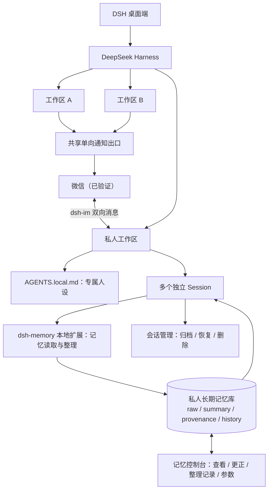

# DeepSeek Harness Private AI Workspace

> 基于 [DeepSeek Harness](https://github.com/deepseek-ai/deepseek-harness) 的**私人 AI 工作区架构实践**：专属人设、跨会话长期记忆、自动整理、可视化管理、会话归档/删除，以及通过第三方插件接入即时通讯。
>
> **项目状态：方案分享 / 复现参考（非一键安装包）**。这是个人本地实践，尚未发布经过脱敏、独立安装验证的完整定制插件源码；部分功能为规划项，请阅读下方状态表。

## 🗺️ 架构图


> **图片说明：** 这张图展示了已实现的架构及后续改进方向。其中“新建会话触发全工作区整理”和“跨会话统一累计 20 轮”仍属于**规划中的增强功能**，不能把它们理解为当前插件已经实现。具体以本 README 的功能状态为准。

## ✨ 想解决什么问题？

同一个私人 AI 可能同时有微信聊天、桌面技术讨论、日常闲聊等多个独立会话。希望它们**各自保留对话上下文，却共享同一套人设和长期记忆**；同时，普通工作区的 AI 不应获得私人记忆的读取或修改权限。

本方案区分三个逻辑工作区：

| 工作区 | 用途 | 私人人设 / 长期记忆 | IM 权限 |
| --- | --- | --- | --- |
| **私人工作区** | 私人 AI、日常聊天、技术任务 | 专属人设与独立长期记忆 | 已验证微信双向交互 |
| **工作区 A** | 普通任务、研究、开发 | 不注入私人内容 | 可通过共享通知出口单向通知 |
| **工作区 B** | 普通任务、研究、开发 | 不注入私人内容 | 可通过共享通知出口单向通知 |

三个工作区只是**示意名称**，并非必须使用的目录名；部署时请根据自己的环境建立工作区。工作区 A / B 的通知依赖自定义通知脚本、权限和当前运行环境，并非 DSH 自带的通用能力。

## 🧩 方案如何工作？



- **会话层：** 不同 Session 保留各自上下文；私人工作区的根会话共享一份长期记忆库。
- **人设层：** 在私人工作区根目录使用 `AGENTS.local.md`，避免把私人角色设定写进所有工作区通用配置。
- **记忆层：** 采用 `dsh-memory` 的本地修改分支，加入私人作用域限制、来源归属校验、自动 Curator、版本历史及记忆控制台。不是安装原版 `dsh-memory` 就自动获得全部功能。
- **数据生命周期：** 永久删除聊天会话**不等于**删除已保存的长期记忆；会话删除需要同步清理待整理游标与关联状态。
- **权限层：** 区分“已认证用户在管理界面管理数据”和“某个工作区中的 AI 自主调用工具”；模型工具不得越权枚举、读取或删除其他工作区内容。

## ✅ 功能状态（截至 2026-10）

| 功能 | 状态 | 说明 |
| --- | --- | --- |
| 私人工作区人设注入 | ✅ 已实现并验证 | `AGENTS.local.md`，其他工作区不加载私人设定 |
| 独立会话共享私人长期记忆 | ✅ 已实现并验证 | 曾验证删除源会话后仍可在新会话召回记忆 |
| 每 **20 个有效回合**自动整理 | ✅ 当前机制 | **按会话**跟踪待整理回合；Curator 可判断无需写入任何记忆 |
| 孤儿 / 非活跃会话整理 | ⚠️ 有实现 | 有兜底逻辑，不能等同于“新建会话立即整理”，成功路径需持续验证 |
| 记忆控制台 | ✅ 已实现 | 查看、编辑、删除、恢复、整理记录、参数管理 |
| 记忆来源追溯及安全约束 | ✅ 已实现 | 来源校验、敏感凭据拒写、操作历史；仍建议独立审计 |
| 会话归档、恢复、永久删除 | ✅ 已实现并修复主要缺陷 | 依赖本地定制会话管理扩展，非 DSH 原生一键功能 |
| 微信与私人工作区交互 | ✅ 已接入微信 | 经第三方 `dsh-im`；微信与桌面**跨端长期记忆完整验收**仍应单独验证 |
| 工作区 A / B 向微信单向通知 | ⚠️ 部分验证 | 基于独立脚本和插件投递接口，存在运行权限及环境依赖 |
| **所有私人会话合计 20 轮触发整理** | 🧪 **规划中** | 目前不能宣称已实施 |
| **微信 `/new` / 桌面新建会话触发全工作区整理** | 🧪 **规划中** | 已提出设计，尚无实施完成及回归验收证据 |

> 自动整理并不等于每次都会产生新记忆：模型应根据对话证据判断价值，允许返回空结果，并保留可追溯的来源。

## 📱 即时通讯支持范围

本项目使用的 IM 接入能力来自第三方插件 **[@xmanrui/dsh-im](https://github.com/xmanrui/dsh-im)**。

- **本项目实际接入：微信。** 不应把其他平台描述为本项目已经部署或测试通过。
- **上游插件支持：** QQ、飞书、钉钉、企业微信、Slack、Telegram、Discord、WhatsApp 等；具体可用渠道、接入方式和版本限制以 [dsh-im README](https://github.com/xmanrui/dsh-im#readme) 为准。
- **其他渠道在本方案中的适配情况：未经验证。** 特别是自定义的跨工作区**单向通知**链路，不保证换一个 IM 平台便可直接复用。
- 微信仅绑定私人工作区进行双向对话；工作区 A / B 使用共享通知出口，**不会因此获得微信回复权或私人长期记忆权限**。

## 🛠️ 复现思路（给 DSH / 开发者）

> 以下是**实施路线与验收要求**，不是已经打包好的安装脚本。请在自己的测试环境中先评估 DSH 版本与插件 API；不要直接复制他人的 Profile、记忆数据库或 IM 凭据。

1. **确认环境。** 安装 DeepSeek Harness；本方案的本地验证基线为 Desktop `0.2.1-rc.3`。不同版本可能改变会话、插件、设置和宿主 API，必须重新核对兼容性。
2. **建立工作区。** 创建私人工作区、工作区 A 和工作区 B。按**注册表归属和精确工作区标识**隔离，不要仅用目录前缀判断（例如一个工作区可能嵌套在另一个目录下）。
3. **配置私人 AI 人设。** 在私人工作区根目录编写 `AGENTS.local.md`；可使用 `CLAUDE.md` 补充记忆行为规则。验证私人新会话加载，而 A / B 不加载。
4. **扩展记忆插件。** 参考 [haitang1/dsh-memory](https://github.com/haitang1/dsh-memory)，在合规的本地分支中加入：独立 `memoryDir` / scope、仅私人根会话可访问记忆工具、每会话 20 有效回合整理、来源与证据校验、journal / 历史与摘要、并发写入保护。
5. **实现记忆控制台。** 通过 DSH 设置页扩展展示记忆条目、摘要、来源、Curator 记录和可编辑参数。所有管理接口必须验证用户身份；认证服务缺失时应**拒绝访问**，不能仅依赖 `localhost`、Origin 或 Host。
6. **接入会话管理。** 为归档、恢复和删除提供用户管理入口；模型删除工具按调用工作区限制范围。删除会话时清理关联 `pending/owned` 等状态，但不连带清空长期记忆。不要在生产数据上验证删除。
7. **接入微信（可选）。** 按 [dsh-im 上游安装说明](https://github.com/xmanrui/dsh-im#安装) 安装并绑定私人工作区。若需要 A / B 的单向通知，另外开发经过授权、可失败重试的共享投递脚本；它与 IM 私聊接入是两个独立能力。
8. **独立验收。** 至少检查新会话人设、跨会话召回、三工作区工具/注入隔离、记忆 CRUD 与来源、无认证请求拒绝、归档/删除后的索引与游标清理，以及微信 `/new` 的实际表现。

### 向 DSH 描述需求时，特别强调

```text
请按“私人工作区 + 工作区 A + 工作区 B”的结构复现本 README 中
“已实现”部分的功能。先读取本机 DSH 版本和可用插件 API，
给出差异、修改范围和安全测试方案，然后分阶段实施。

不要假定原版 dsh-memory 自带本地定制的记忆控制台与来源校验；
不要把工作区共享 20 轮及新建会话统一整理当成已完成功能；
不要修改官方 DSH 核心；不得恢复、清理或上传任何真实私人记忆、
会话日志、Token 与 IM 凭据。

每完成一阶段提交变更清单与实际验收证据。
```

## 🔐 安全与隐私

- 不上传 `~/.dsh`、实际 Profile、`workspaces.json`、`state.json`、`pending-turns.json`、`raw_memories.md`、聊天日志、备份或令牌；公开示例必须用假路径和假 ID。
- 检查 Git **全部提交历史**中的隐私数据；仅从最新文件删除敏感内容不代表历史已清除。
- 记忆模型输出必须有来源约束：**读到文件或听到助手自述，不等于真的与用户共同经历过某件事**。
- 插件权限、管理接口认证、工具能力边界、并发游标及敏感数据拒写都需要验证。
- 长期记忆可能含私人信息；公开仓库应只放**合成测试数据**。

## 🤝 上游项目与许可证

- [DeepSeek Harness](https://github.com/deepseek-ai/deepseek-harness) — 宿主平台。
- [xmanrui/dsh-im](https://github.com/xmanrui/dsh-im) — 第三方 IM 接入插件。
- [haitang1/dsh-memory](https://github.com/haitang1/dsh-memory) — 记忆插件改造参考。

本仓库当前主要包含设计图和实施思路，**不宣称这些上游项目由本仓库维护**。如以后发布修改后的插件代码，须核对每项依赖的许可证，并保留相应版权及许可声明；不得在未经核查时直接为第三方代码套用统一许可证。

## 📌 项目声明

本项目是非官方的个人实践与技术分享，**并非 DeepSeek 官方发布、赞助或提供支持的产品**。不同机器、DSH 版本、IM 渠道和权限环境可能需要调整；请先在测试数据上复现，再用于长期运行。
