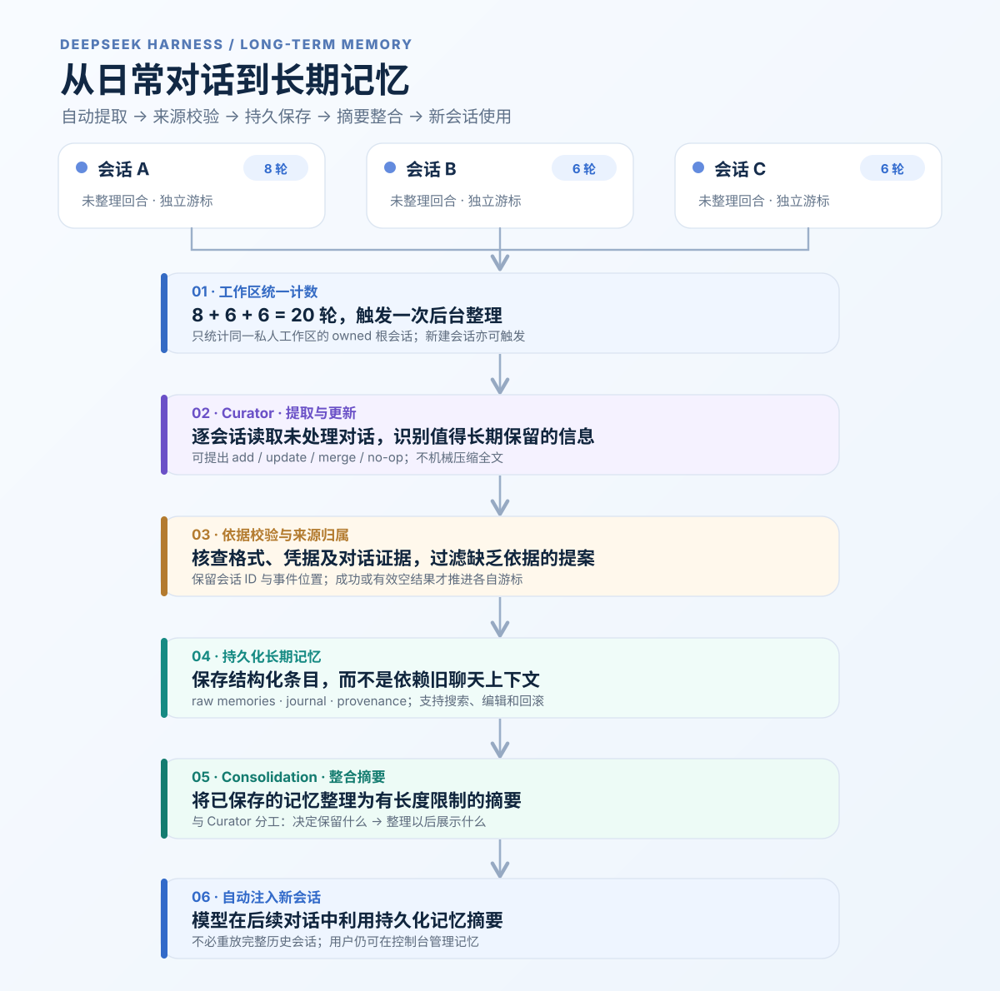

# DeepSeek Harness 长期记忆系统 · 自动总结与跨会话记忆 · v0.2.0 技术预览版

> **让 AI 不只是保存聊天记录，而是从对话中提取值得长期保留的信息，形成可更新的记忆，再在后续会话中使用。** 本项目为 DeepSeek Harness 提供一套**可复现、可审计、按工作区隔离的长期记忆解决方案**：Curator 自动提取事实与偏好，Consolidation 整合为有界摘要，后续会话自动注入；用户可以查看、编辑、追溯和恢复记忆。
>
> **Technical Preview / 非官方项目 / 非一键部署**。插件代码和自动化测试已公开；真实微信 `/new`、真实外部模型累计 20 轮以及桌面冷启动的端到端验收尚未完成。请先阅读[状态与限制](STATUS.md)和[安装说明](INSTALL.md)。



*长期记忆主流程：多个私人会话累计有效回合 → Curator 提取并校验 → 持久化记忆 → Consolidation 整合摘要 → 后续会话自动使用。图示为 v0.2.0 设计与测试覆盖范围，真实外部模型及微信端到端验收仍待完成。早期的[私人 AI 工作区整体架构图](docs/legacy/DeepSeek%20私人%20AI%20工作区架构图.png)已归档。*

## 为什么做这个项目？

AI 助手的一次会话结束后，重要的偏好、约定与经验很容易散落在历史聊天里；仅依靠对话长度和手工提示词，难以维持长期一致性。

这份方案希望解决四个具体问题：

1. **跨会话持续记忆**：把经过验证的事实与约定保存在独立持久化记忆库中，下一次对话自动提供有界摘要。
2. **自动整理，而不必手动总结每段聊天**：同一私人工作区的多个根会话累计 **20 个待整理有效回合**即可触发 Curator；新建私人会话也可启动整理。
3. **记忆可控、可追溯**：记录来源会话和事件位置，提供搜索、修改、删除、版本历史与回滚，避免把未经证实的模型推测写成用户经历。
4. **工作区分离**：私人工作区使用长期记忆；工作区 A、工作区 B 不获得同一套记忆工具和提示词注入。注意这是**应用层**隔离，不是操作系统文件权限隔离。

这不是通用的云端记忆 SaaS，也不承诺任何模型“永不遗忘”。它是一套适配 **DeepSeek Harness Desktop** 的本地插件架构与复现实践。

## 工作原理：对话如何被总结为长期记忆？

这里的“自动总结”不是每隔 20 轮把所有聊天压缩成一篇文章，更不是把旧会话全文塞进新会话。系统分为 **记忆提取（Curator）** 和 **记忆整合（Consolidation）** 两步：

```text
多个私人会话的对话事件（A / B / C ...）
          │  每个会话分别记录 pendingTurns 和 cursor
          ▼
工作区统一计数：所有 owned 根会话未整理回合之和
          │  达到默认 20 轮 / 新建私人根会话 / 微信 /new（需补丁）/ 空闲兜底
          ▼
Curator：按会话读取游标之后、已经结束的对话事件
          │  提出 add / update / merge / no-op，不是机械摘抄全文
          ▼
校验：格式、条数、凭据、对话证据与来源归属
          │  有效结果写入 raw 记忆、journal、provenance
          │  各会话仅在成功或有效空结果后推进自己的 cursor
          ▼
Consolidation：基于记忆条目生成/更新有长度限制的摘要
          ▼
下一次构建提示词：自动读取并注入长期记忆摘要
          ▼
新会话能利用已保存的信息，用户也可从控制台管理
```

**① 何时整理？** 私人工作区中的会话 A 待整理 8 轮、B 为 6 轮、C 为 6 轮，合计 **20 轮**，就触发一个工作区整理任务。Curator 依次处理各会话尚未整理的内容，而不是把 A/B/C 的原文混成一段，来源和处理游标仍分别保留。新建私人根会话也会触发已有待处理内容的整理；微信 `/new` 的即时触发依赖本地桥接补丁，真实微信端到端效果尚待验证。

**② 提取什么？** 假设用户明确说：“以后帮我写报告时，先提供结构化提纲，再写结论。” Curator 可以提出一条候选记忆：“用户偏好先看结构化提纲，再阅读报告结论。” 系统会尝试将这条候选记忆对回原会话的证据；没有足够依据时应丢弃。**不是每段闲聊都必须产生记忆**：无新事实时允许 no-op，旧记忆也可以被更新或合并。

**③ 如何变成长期记忆？** 通过校验的结果保存为可查询的持久化条目，记录来源会话、事件序号和证据；发生有效写入后，再由 Consolidation 整合条目，生成有界的记忆摘要。**Curator 负责判断“记住什么”；Consolidation 负责组织“以后给模型看什么”。**

**④ 如何在新会话生效？** 插件在生成提示词时读取摘要并注入，通常不需要把旧会话完整重放。用户可通过记忆控制台搜索、修改、删除、查看来源和恢复历史版本。

**⑤ 如何避免遗漏或重复？** 每个会话有独立游标；失败批次保留待处理回合，任务期间新增的回合留给后续整理，并通过锁、去重和来源记录控制重复写入。单任务最多处理 8 批、每批最多 8 个会话，超过上限的会话延后处理。

**验证边界：** 以上是当前源码的设计及自动化测试覆盖范围，**不是“永不遗忘”或真实模型提取质量的保证**。隔离 Curator harness 使用确定性模拟模型；真实外部模型、真实微信 `/new` 与 DSH 桌面完整冷启动仍待端到端验收。

## 核心功能

| 能力 | v0.2.0 实现方式 | 验证状态 |
| --- | --- | --- |
| 跨会话长期记忆 | 持久化 raw/summary、提示词注入、14 个 `memory_*` 工具 | 有单元测试；宿主端到端有限 |
| **工作区统一累计 20 轮** | 对全部 owned 私人根会话的未整理 `pendingTurns` 求和，不依赖 `lifetimeTurns` | 自动化测试通过 |
| **批量 Curator 整理** | 最久未处理优先；每批最多 8 个会话，每任务最多 8 批；每个会话独立游标 | 隔离 harness 有历史通过证据；本轮未重跑完整 harness |
| 新建会话触发 | 桌面私人根会话 `startup` 触发，`resume` 不触发 | 合成事件通过；真实桌面冷启动待验 |
| 微信 `/new` 触发 | 可选 [`dsh-im` 本地桥接补丁](patches/README.md) | 模拟事件和补丁矩阵通过；真实微信未验 |
| 来源追踪与安全筛选 | provenance、transcript attribution、凭据拒写、失败重试与游标恢复 | 单元/MCP 安全测试通过；仍有边界限制 |
| 管理控制台 | 查询/修改记忆、查看来源、历史与回滚 | 相关测试通过；UI 视觉未复验 |
| 独立 MCP 记忆接口 | 可选 stdio MCP server，写入凭据检测与作用域白名单 | 安全回归通过；与宿主插件安全路径不完全相同 |

**例子：** 会话 A 待整理 8 轮 + 会话 B 6 轮 + 会话 C 6 轮 = 20 轮，触发一次工作区任务；A/B/C 分别拥有自己的游标和来源证据，成功处理后仅扣除已经处理的回合。详见[插件设计](plugins/memory/README.md)和[自动化测试](review/v0.2.0/ACCEPTANCE.md)。

## 项目组成

仓库最初以 `dsh-private-ai-workspace` 命名，因为项目起源于完整的私人 AI 工作区方案。**从 v0.2.0 起，核心目标已明确为自动总结对话并提供长期记忆**；微信、会话管理和通知属于配套能力，仓库旧名称不代表核心功能的优先级。

```text
dsh-private-ai-workspace/
├── plugins/
│   ├── memory/               核心：dsh-memory-scoped 0.2.0、Curator、MCP、控制台、测试
│   └── session-manager/      辅助：按工作区隔离的会话删除插件（本地修改版）
├── patches/                  可选：dsh-im 的微信 /new 事件桥接补丁及安全测试
├── scripts/notify/           辅助：工作区 A/B 单向通知微信
├── examples/                 匿名化的人设与配置模板
├── tests/                    原有整体隔离与打包测试
├── review/                   v0.1 历史审计及 v0.2.0 验收证据
├── INSTALL.md                安装与升级说明
├── ARCHITECTURE.md           组件与数据流
├── STATUS.md                 功能状态、风险和未验证项
└── THIRD_PARTY_NOTICES.md    上游许可与修改说明
```

**记忆插件是主体。** 会话管理插件和通知脚本是可选的完整工作区方案，**不需要安装它们才能理解长期记忆的实现**；微信 `/new` 即时触发则需要补丁，其他方式的整理与该补丁无关。

## 快速开始（Windows / DSH Desktop）

环境基线：DSH Desktop `0.2.1-rc.3`；Node.js `>=20.3`。完整安装步骤见 [INSTALL.md](INSTALL.md)，升级已有部署先读 [MIGRATION.md](plugins/memory/MIGRATION.md)。

1. 将本仓库的 `plugins/memory/` 放到稳定的本地目录，作为 `dsh-memory-scoped` 的本地 `link:` / `file:` 插件加载；**不要仅用 npm 同名包替代**。
2. 在 DSH profile 的 `cordis.patch.yml` 中配置 `privateWorkspace`（非空的绝对路径）、`memoryDir`、`scopedMemory: true`。参考 [根配置示例](examples/config.example.yml) 与 [插件配置示例](plugins/memory/examples/config.example.yml)。
3. 重新加载插件或重启 DSH，检查诊断文件及私人根会话的 `memory_*` 工具，并确认其他工作区拿不到这套工具。
4. 如需微信 `/new` **立即**触发，按 [patches/README.md](patches/README.md) 对已安装的 `@xmanrui/dsh-im` 执行可重复应用的本地补丁；插件升级后须重新应用，先备份并测试。
5. 验证工作区总量、日志和游标；真实记忆首次整理前请备份 `<memoryDir>`。

**注意**：如果机器上已经安装过其他版本的记忆插件，**不要让旧包和 `dsh-memory-scoped` 同时写入同一个 `memoryDir`**。升级操作必须先停旧插件、备份数据，再按 [迁移说明](plugins/memory/MIGRATION.md) 处理。

## 运行测试

```powershell
cd plugins\memory
node --test
node scripts/check-release.mjs
node scripts/check-release-negative.mjs
cd ..\..
node patches/test-patch.mjs
```

本次候选包在 Linux / Node.js 22.16.0 上独立复核：**187 项测试，184 通过、3 跳过、0 失败**；MCP 安全测试 **22/22 通过**，补丁安全矩阵通过。会话管理插件沿用 v0.1.0，先前 **14/14 通过**。三项跳过涉及 DSH 宿主 peer 依赖；[完整 Curator harness](plugins/memory/acceptance/README.md) 本轮因依赖缺失**未独立重跑**。详见[测试记录](review/v0.2.0/TEST-REPORT.md)。

## 安全边界与已知限制

- **不是操作系统级沙箱**：其他 Agent 若共享系统账户并拥有文件读取权限，仍可能读取 `<memoryDir>`；需要强隔离，请使用独立系统账户、ACL 或沙箱。
- **独立 MCP 与宿主工具并非完全相同的安全入口**：MCP 写入路径已经加入更严格的内容、标签和合并校验；宿主插件的 `memory_merge`/`memory_delete` 尚未完全同步这些 MCP 防护，不应宣称所有入口已经同等加固。
- **旧数据读取不自动脱敏**：历史遗留的凭据可能通过搜索/读取出现；不要向记忆库写入密钥，敏感历史数据需要自行清理。
- **本地 IM 投递接口无自身认证**；通知脚本仅做 loopback、进程归属和路由探测，并不改变上游接口能力。
- **真实验收尚缺**：微信实际发送 `/new`、真实外部模型 20 轮、完整 Desktop 冷启动、干净环境部署及控制台视觉回归。**不要将本项目用于存放高敏感秘密或宣称生产级安全。**
- 微信桥接只针对经测试的 `@xmanrui/dsh-im` 安装形态；升级后可能需要重新打补丁。64 个以上待整理会话仍可能 deferred。

更多信息：[功能状态](STATUS.md) · [架构与信任边界](ARCHITECTURE.md) · [安全审查（v0.1 历史）](review/SECURITY_AUDIT.md)。

## 许可、来源与致谢

本仓库为非官方社区项目，**与 DeepSeek 官方无隶属或背书关系**。原始插件及衍生代码按各自 MIT LICENSE 保留上游版权；原创文档/脚本署名 `miyouchen52-bot`。详情见 [LICENSE.md](LICENSE.md)、[THIRD_PARTY_NOTICES.md](THIRD_PARTY_NOTICES.md)。

感谢 [DeepSeek Harness](https://github.com/deepseek-ai/deepseek-harness)、[haitang1/dsh-memory](https://github.com/haitang1/dsh-memory)、[liuyu-f/session-cascade-delete](https://github.com/liuyu-f/dsh-plugin-session-cascade-delete) 和 [xmanrui/dsh-im](https://github.com/xmanrui/dsh-im) 的开发者。
